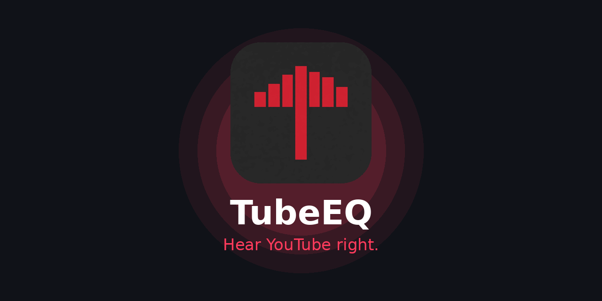

  

  
  
  
  

<h3 align="center">Hear YouTube right.</h3>

  <b>TubeEQ</b> is a free, open-source 10-band equalizer for YouTube. 
  No tracking. No ads. No paywall. Just better sound. 
  <a href="https://dongdarealest.github.io/TubeEQ/">🌐 Website</a> ·
  <a href="https://github.com/Dongdarealest/TubeEQ/releases/tag/v1.0.1">⬇️ Download v1.0.1</a> ·
  <a href="https://github.com/Dongdarealest/TubeEQ/issues">🐞 Report a bug</a>

---

### ✨ Features

- 🎚️ **10-band EQ** (31 Hz – 16 kHz) with plain-language labels
- 🎛️ **5 studio effects** , clarity, ambience, surround, punch, lossless restore
- 🔴 **Floating button** on the player , quick presets without leaving the video
- 🧠 **Per-channel memory**, your preset follows each channel
- 🔗 **Shareable presets**, every setting is a short code
- 💾 **Backup & restore**, all presets in one JSON file
- 🔊 **Volume boost to 200%** with limiter + clip indicator
- 🌍 **12 languages**

### ⬇️ Install (2 minutes)

1. Download `tubeeq-v1.0.1.zip` from [Releases](https://github.com/Dongdarealest/TubeEQ/releases/tag/v1.0.1)
2. Unzip it somewhere permanent
3. `chrome://extensions` → Developer mode → **Load unpacked** → pick the folder → `F5` on YouTube

Updating? Unzip **over the same folder** and hit reload ↻, never a new folder.

### 🤝 Contributing

- Got a great preset? Add it to [`presets.json`](https://github.com/Dongdarealest/TubeEQ/blob/gh-pages/presets.json) via pull request
- Found a bug? [Open an issue](https://github.com/Dongdarealest/TubeEQ/issues)

### 🔒 Privacy

Only asks for `youtube.com`. Settings stay in your browser. Nothing is sent anywhere. [Full policy](https://dongdarealest.github.io/TubeEQ/privacy.html).

### 📄 License

MIT - do whatever you want with it.
